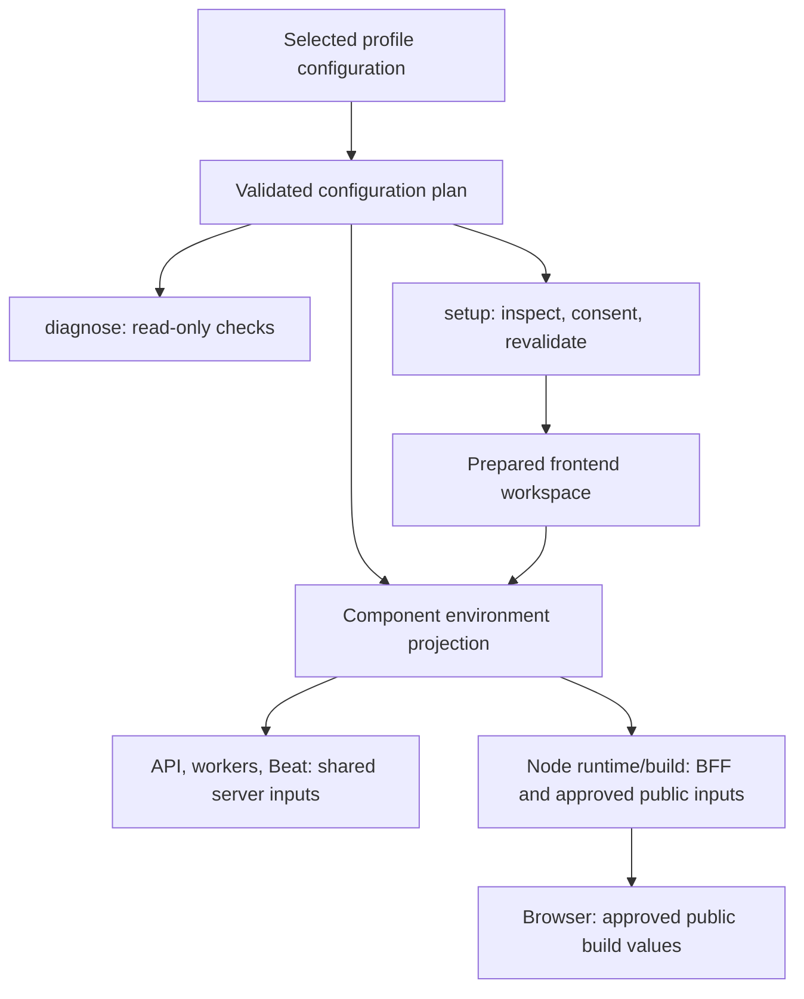
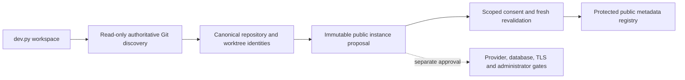

# Configuration reference

Scope: development configuration boundaries, SBO-98 Phases 1–4 and the separately
reviewable Native status and gated enrollment increments of Phase 5, based on
approved main `69e71088d7fef06874fe1e2eac7a53db0fd2f333`. Examples are templates,
not one interchangeable environment.

## Pure development configuration plans (SBO-98, Phase 1)

The side-effect-free `scripts/dev_config.py` library is introduced against the
approved main baseline `69e71088d7fef06874fe1e2eac7a53db0fd2f333`. Read-only
diagnostics and prepared Legacy startup use it through the shared read-only
snapshot adapter. Controlled setup inspects an independent action plan before
delegating authorized preparation. Native operator status has an explicit opt-in
adapter; existing privileged entry-point guards remain intact. Configuration
files, protected private readers and process-ownership behavior remain
authoritative. This is a library, not another
environment-management CLI.

Callers supply already-read snapshots and explicit profile, configuration family,
native repository/state paths and operating system. Pure text parsers preserve
the managed JSON-string, literal PowerShell and noninterpolating dotenv formats.
Adapters must retain the existing ACL, symlink/reparse-point, profile
selection and runtime-family pinning checks before reading protected files.

The resolver copies its inputs into immutable environment, provenance,
classification and component maps. It never reads ambient environment variables
or files, imports application startup, connects to services, creates credentials,
initializes state or writes files. Managed `existing` resolution preserves
process-then-saved inspection precedence; `startup` models fixed settings for an
already prepared installation. It deliberately refuses missing saved database
configuration or a PostgreSQL provider change instead of inventing credentials or
preparing a database. Windows/env and Greenfield precedence remains covered by
parity tests against the current launcher.

The database target contains only host, port and database name. Passing local
target policy does **not** establish live identity, readiness, process ownership
or permission for initialization or administrator enrollment. The new library
refuses query/fragment-bearing database URLs, control characters, ambiguous
leading database-path slashes, port zero and case-variant environment names.
Some old Windows/env inputs accepted these forms; they require explicit review,
not silent normalization or removal of TLS options. Diagnostics report these
conditions without changing files. Prepared Legacy startup uses the same target
policy instead of normalizing an ambiguous saved target.

Authentication metadata records explicit supplied flags without selecting or
converting a mode. `authentication_enabled=None` means unresolved/absent; omitted
component defaults and differing backend/frontend boolean handling still need
diagnosis. Existing Native, HCL.CS, Entra, mixed and disabled values are preserved
in inspection plans. Setup/start require authenticated development with the
development tenant bypass disabled, and refuse incompatible existing modes
instead of converting them.

Unknown settings are classified conservatively as secret. Environment values
are excluded from plan representations, but the environment maps intentionally
contain secrets and must never be serialized into logs or issues. Frontend and
public projections use explicit allowlists: the BFF keeps its legitimate session
encryption key and Redis session connection, but not database, Native signing,
SMTP, outbox or provider-storage secrets. Browser projection permits only
reviewed public names. Runtime spawning and the development frontend build now
apply role projections at the actual child-process boundary. API/worker/Beat
projections initially retain complete shared Settings/task inputs for
compatibility; this is not least privilege between those three backend roles.
Further narrowing requires additional consumer review.

Shared operator configuration now supports read-only status and a staged Native
enrollment adapter whose public default remains BLOCKED. Live enrollment still
requires separately reviewed readiness attestations and authorization. It must not
reuse mutable preparation as a resolver, automatically migrate/create databases,
replace saved keys or install certificate trust.
The Native bootstrap CLI can opt into the shared resolver for aggregate status
only; its profile-based create/resend execution remains unavailable. The separate
launcher create/resend entry points are described under the readiness gate below.
HCL.CS first-eligible-user provisioning still requires Engineering Lead and
identity-provider-owner design approval.

## Read-only diagnostics (SBO-98, Phase 2)

Use the single public launcher from the intended checkout:

```sh
python scripts/dev.py diagnose
python scripts/dev.py diagnose --profile legacy --legacy-config managed
python scripts/dev.py diagnose --profile legacy --legacy-config windows
python scripts/dev.py diagnose --profile greenfield
```

`diagnose` is the primary command. `doctor` is a temporary compatibility alias
which emits one deprecation notice on stderr and uses the same checks/exit policy.
Existing supported `--check` forms use the diagnostic path before mutable setup
or runtime dispatch, including `python scripts/dev.py setup --check`. Combining
diagnostics with setup planning/provider selection, dependency repair,
provisioning, database initialization/migration or frontend-build flags is a
usage error, not permission to apply those changes.

The command inspects already selected configuration and uses bounded observational
checks. It never installs packages, prepares a virtualenv, writes configuration,
generates keys/certificates, changes certificate trust, creates/migrates a database,
creates users/tokens/grants, acquires or updates runtime locks, refreshes ownership,
starts/stops services or publishes Celery control RPC/tasks. PostgreSQL observations
use read-only transactions. Runtime records are observations only: uncertain or
reused PIDs are never adopted, cleared or killed. Existing UNKNOWN records remain
protected.

Observational network requests and protocol handshakes can appear in service
access logs. HTTPS inspection uses a verified TLS handshake rather than fetching
a Next.js page that could trigger development compilation. Pinned leaf verification
does not establish OS/browser trust. Never bypass certificate validation to make
a diagnostic check pass.

Reporting deadlines also cover DNS and slow protocol headers. A timed-out probe
runs only read-only operations in a daemon thread and may finish until CLI exit;
the thread is never forcibly cancelled or used for preparation. As explicitly
approved for SBO-98, timeout cleanup may stop only short-lived Node, Docker or
native trust-tool children created by that diagnostic through their original
`Popen` objects/handles. It never signals a saved PID, managed service or unrelated
process. External helpers have their own timeouts; a reporting timeout does not
prove an in-flight read-only operation has completed. Database probes retain
server-side read-only/statement limits and close without committing. A library
caller that keeps its process alive must account for that residual probe lifetime.
API inspection uses the inert service-info endpoint and selected Native readiness;
it avoids `/health`, whose NVD mirror read path can attempt a settings seed.

HTTP metadata/health probes use direct selected endpoints rather than ambient
proxy settings. HCL environments requiring a corporate proxy need an explicitly
reviewed transport adapter; successful direct discovery does not prove provider
registration or login. Ambiguous relative HCL CA paths and unreviewed Redis URL
query options are reported for review; diagnostics never rewrite or discard them.

Results carry a safe component, status, reason and corrective guidance. Connection
strings, passwords, private keys, tokens and raw provider/database exceptions are
not diagnostic output.

| Status | Meaning |
| --- | --- |
| PASS | The bounded check succeeded; it establishes only the stated observation. |
| WARN | Review a limitation or nonrequired condition; it does not authorize repair. |
| FAIL | A required check failed with actionable guidance. |
| BLOCKED | A required check cannot proceed safely until a prerequisite/approval is resolved. |
| SKIPPED | The check is not applicable or has no safely observable running component. |

Exit 0 means there are no failed or blocked required checks; 1 means a required
check failed or is blocked; 2 means invalid usage, including mutation-flag
combinations; 130 means cancellation. Existing `status` exit 3 for stopped/unhealthy
runtime remains unchanged. An intentionally stopped application is not evidence
of a crashed worker or corrupted installation.

Diagnostic coverage distinguishes:

- dependency/toolchain presence from installation and build acceptance;
- configuration provenance/conflicts from permission to rewrite private files;
- approved target identity, connectivity and schema state from initialization;
- Native JWT/session/rate-limit/outbox/mail prerequisites from live activation;
- HCL.CS configuration/TLS observations from provider registration and actual login;
- aggregate enrollment state from authorized privileged provisioning;
- existing certificate validity, verified TLS and independent native trust;
- recorded process identity, available heartbeats and bounded service health
  from full application readiness and task/mail delivery.

Missing enrollment, pending activation or a schema mismatch produces corrective
guidance only. Native enrollment still delegates to the approved bootstrap and
activation services under explicit operator authorization and exact database
identification. HCL.CS has no newly approved first-eligible-user provisioning flow.
Do not invoke bootstrap helpers as diagnostic dry runs: some wrappers commit or
write audit records even on refusal.

For an existing machine, preserve configuration, credentials, certificates and
runtime records; run `diagnose` with the intended profile/family, review its safe
findings and seek authorization for the specific corrective action. Do not reset
data, rotate keys, alter trust or switch authentication/profile to bypass a check.
Controlled setup is described below. No new live platform/provider acceptance is
implied by adding diagnostics or passing unit tests.

## Controlled setup and prepared startup (SBO-98, Phase 3)

Use the selected checkout/profile and review its plan before preparation:

```sh
python scripts/dev.py setup --plan --profile legacy --legacy-config managed
python scripts/dev.py setup --profile legacy --legacy-config managed
python scripts/dev.py --profile legacy --legacy-config managed
python scripts/dev.py diagnose --profile legacy --legacy-config managed
```

`setup --plan` is read-only: it reports required actions and blockers without
prompting for consent, installing packages, creating private files, connecting to
the database or changing runtime records. It may continue inspection in an
already-existing project interpreter when that is required to validate existing
material; this handoff does not create or repair a virtualenv. `setup --check`
continues to mean diagnostics, not setup planning or permission to apply a plan.

Interactive `setup` requires an explicit `yes` for each required category:
project dependencies, new configuration, fresh secrets, missing certificates,
the frontend workspace, explicit Greenfield data providers, database
initialization/migration and optional frontend build. Declining any category
applies nothing. Noninteractive setup with
required actions refuses rather than assuming consent. A successful plan-only or
unchanged invocation returns 0; blockers, declined authorization and changed
inputs return 1; cancellation/EOF during consent returns 130.

The plan is inspected again after consent. An internal fingerprint covers
selected inputs, private-file observations, manifests and preparation/migration
source. Changed inputs, new actions or blockers require a new plan. The
fingerprint and private values are not displayed. Authorization is scoped to the
current actions and survives only a validated project-interpreter handoff; it is
not a reusable public approval switch or permission to create privileged users.
After that handoff, preparation takes the existing checkout lifecycle lock and
checks runtime records again. A concurrent launcher operation or newly appeared
record blocks preparation. Planning and diagnostics never take that lock.

Ordinary startup requires an existing project interpreter, matching Python/npm
dependency stamps, selected configuration, persistent keys and valid existing
HTTPS material. It checks connectivity and current schema before workers start.
It does not install dependencies, create a database, migrate a schema, discover
credentials, generate keys or create a certificate. A missing preparation gate
directs the developer back to a reviewed setup plan. PostgreSQL credentials are
never adopted from repository `.env`, pgpass or known container defaults.

For a genuinely new Managed Legacy Native installation, first obtain operator
approval for the exact local empty target and start the approved local
PostgreSQL, Redis and Mailpit services. The following is a procedure example,
**not an operation executed during this implementation**:

```sh
python scripts/dev.py setup --plan --profile legacy --legacy-config managed --postgres-provider local --redis-provider local --mailpit-provider local --initialize-database --confirm-database sbom_analyser_dev
# Only after the database operation is independently approved, review and consent:
python scripts/dev.py setup --profile legacy --legacy-config managed --postgres-provider local --redis-provider local --mailpit-provider local --initialize-database --confirm-database sbom_analyser_dev
```

The exact-name guard runs before preparation. Fresh setup requests the intended
PostgreSQL credentials interactively, validates them through read-only inspection
and requires an empty application schema before generating initial Native keys.
New managed configuration is published without replacing an existing file. A
missing configuration next to a populated database is a recovery case, not
permission to generate replacement keys. Initialization and migration retain
their existing empty-target, UUID-history and platform safeguards; neither is
selected by ordinary startup.

Legacy setup reuses only already-running selected local/Docker dependencies; it
does not create or resume Legacy containers. A stopped or unverified selected
provider blocks preparation. Fresh managed PostgreSQL cannot adopt a Docker
installation using default credentials; preserve an approved existing complete
configuration or use explicitly reviewed Greenfield provisioning for a new
private container installation. Provider flags never authorize conversion of a
saved installation. Greenfield provisioning requires its exact database
confirmation, independently approved CA and separate preparation categories;
creating PostgreSQL resources does not initialize application schema unless the
explicit initialization flag is also selected.

Existing Legacy Windows/env HCL.CS settings remain supported. Setup preserves
their provider, authentication, CA and redirect choices; it does not invent
registrations or require Native signing/outbox keys when Native is disabled.
The BFF's existing session key remains protected. HCL.CS first-eligible-user
privileged provisioning remains blocked pending Engineering Lead and provider
owner approval. Neither setup nor ordinary startup creates an administrator.

Recovery preserves original configuration, credentials, certificates, database
contents and uncertain runtime records. Restore incomplete or invalid original
material rather than deleting it or rotating keys. Any recorded runtime blocks
preparation until its ownership is reviewed and verified stop succeeds. A setup
failure can leave authorized project/private artifacts already created; the
`SETUP_PARTIAL_PREPARATION` report requires diagnosis and a new plan, not automatic
rollback, database reset or broad file cleanup.

Dependency repair is explicit, rather than an ordinary-start side effect:

```sh
python scripts/dev.py setup --plan --repair-dependencies --profile legacy --legacy-config managed
# After reviewing the plan and obtaining the required category approval:
python scripts/dev.py setup --repair-dependencies --profile legacy --legacy-config managed
```

The `project-dependencies` category authorizes rerunning the pinned Python
requirements installer and `npm ci` from the existing manifests/lockfile even
when their stamps match. It does not authorize arbitrary package upgrades,
configuration/key replacement, database operations or certificate trust changes.
Scope, ownership, private-material inspection and plan-revalidation gates still
apply. If neither the invoking nor the existing project interpreter can validate
protected material, setup may remain blocked; repair is not permission to bypass
those checks. Review a new frontend-workspace plan if dependency directory
identity changes. Ordinary start and diagnostics never perform dependency repair.

New managed private configuration and localhost
private keys use exclusive creation and protected Windows DACLs, requiring
persistent-ACL filesystem support. Existing ACLs are not repaired, and failed
creation can retain incomplete new artifacts for operator review. Redirected
certificate/configuration parent paths are refused. System-service
installation and OS/browser root trust are never performed by setup. Native
Windows ownership/DACL inspection uses read-only native metadata APIs on one
handle, with current-user ownership and conservative trusted-grant checks. It
does not launch PowerShell, change ACLs or treat unknown metadata as safe. This
also avoids the confirmed 15-second helper timeout on fresh Windows CI hosts.
Keep checkout/state and test TEMP paths within the machine's supported Windows
path limits; no long-path or other machine policy is enabled automatically.
Native Windows/macOS/Linux, real provider login and fresh-install acceptance remain
separate validation work; documentation and fixture tests do not establish them.

## Component environments and frontend workspace (SBO-98, Phase 4)

The launcher keeps its complete resolved environment for readiness, redaction and
process ownership, but projects a separate environment for each child. FastAPI,
default/reports workers and Beat retain their shared server inputs initially.
Next.js runtime and the explicit development frontend build receive only approved
BFF, browser and operating-system inputs. Database credentials, Native signing
keys, SMTP passwords, encrypted-outbox keys and provider-storage keys are absent
from these Node environments. The BFF still needs its legitimate Redis session
connection and session encryption key; those remain server-only secrets and must
not be printed or copied into browser variables.



Greenfield retains its protected existing reader and private configuration format;
the same role projection applies before its Node runtime/build execution. This
development-only wiring changes neither production Docker/Compose environment
forwarding nor frontend/API contracts or database schema.

Only explicitly allowlisted browser names are projected; an arbitrary
`NEXT_PUBLIC_*` prefix does not authorize publication. Current names cover auth
provider flags, API URL, HCL issuer/client/redirect/logout/scopes and the comparison
fallback. Public endpoint values containing credentials are refused. Public values
still have Next.js build-time semantics: editing runtime settings is not a claim
that an existing browser bundle was rebuilt. Custom API/frontend ports remain in
the parent's ownership metadata and command arguments; they do not need to enter
the Node environment for registration to remain correct.

Next.js automatically loads and can reload `.env*` files from its working
directory. Filtering inherited environment alone would let stripped secrets
re-enter through dotenv. Authorized `setup` therefore offers the
`frontend-workspace` category and prepares:

| Profile | New frontend working directory |
| --- | --- |
| Legacy | `<checkout>/.dev-frontend` |
| Greenfield | `~/.sbom-greenfield-uuid/frontend-isolated` |

The source `frontend` directory, original private environment files and old
Greenfield `frontend`/`frontend-build` directories are retained. Environment files
are never copied into the new workspace. Supported selected-file resolution,
including Legacy Windows/env `frontend/.env.local` layering, happens before role
projection. A read-only Legacy source-environment guard reviews the effective
Next development/test fallback files in their original order. If a file would
supply an approved frontend input absent from the authoritative profile, or an
ambiguous spelling of such a setting, startup refuses instead of silently losing
or adopting it. Unreadable/redirected files also require review. Original files
are not rewritten, expanded or copied; review the selected authoritative profile
rather than moving an old private file into the generated workspace. Greenfield
retains its existing exclusion of source dotenv files.

Verified links point `src`, optional `public` and `node_modules` at their
authoritative source directories. Windows uses nonprivileged directory junctions;
POSIX uses directory symlinks. Setup never enables Developer Mode or changes OS
policy as a fallback. Source links preserve visibility of ordinary atomic source
file saves instead of serving a source snapshot. End-to-end Next.js hot reload
still requires separate acceptance.

An ownership manifest pins repository/source/workspace/parent identities, link
objects and exact targets, and approved public configuration copies. Source
configuration changes require explicit setup refresh; only unchanged,
manifest-owned copies may be refreshed. Modified workspace copies, unknown
existing directories, redirected inputs, removed source configuration and any
workspace `.env*` file block use and remain untouched. Known Next-generated files
and cache directories are permitted with regular-file/directory checks. Startup
and `diagnose` validate this state without creating, repairing or deleting it.
An interrupted setup can leave new artifacts requiring review; do not remove
private or unknown files automatically. This is configuration isolation, not an
OS sandbox around trusted frontend code.

HTTPS uses the original existing certificate/key through absolute paths. The
BFF transaction key defaults to the preserved Legacy
`frontend/certificates/localhost-key.pem` or Greenfield `cert-key.pem`. Explicit
transaction-key, provider CA, Node extra-CA and OpenSSL CA paths retain their
original frontend working-directory meaning when made absolute; private key
material is not copied into the workspace. `SSL_CERT_FILE` and each entry in
`SSL_CERT_DIR` are preserved; empty/ambiguous CA-directory entries require review.
Backend/BFF CA ambiguity still requires review, not a TLS bypass or silent
reinterpretation.

`NODE_EXTRA_CA_CERTS` is retained. Supported `NODE_OPTIONS` are
`--use-system-ca`, `--use-openssl-ca`, `--use-bundled-ca`, `--tls-min-v1.2`,
`--tls-min-v1.3`, `--enable-source-maps`, `--no-warnings`, `--trace-warnings` and
`--max-old-space-size=N` for 100–99999. Their availability still depends on the
selected Node version. Unsupported user options, preload/import hooks and
`NODE_TLS_REJECT_UNAUTHORIZED=0` in resolved runtime configuration fail before
Node/log creation; stronger TLS
settings are not silently discarded. Obtain explicit configuration review
instead of weakening verification to pass the gate.

Frontend runtime/build force `CI=1` and `NEXT_DISABLE_SWC_WASM=1`; telemetry is
disabled by default with `NEXT_TELEMETRY_DISABLED=1` unless explicitly configured
otherwise. These development controls make missing dependencies fail instead of
letting Next repair installations or rewrite lockfiles during startup. They are
paired with a bounded native compiler probe before runtime/build: an owned Node
process loads only an already-installed matching native SWC package and reports
a readiness boolean. It never invokes Next's compiler downloader and receives
only transport metadata, not application/BFF secrets. Missing/incompatible native
bindings direct the developer to a reviewed dependency-repair plan. Timeout
cleanup uses that probe's original owned process handle only; unconfirmed cleanup
blocks retry and reports the owned probe PID. It never targets a saved PID or an
unrelated process. Strictly read-only `diagnose` does not execute this compiler
probe.

The launcher also appends its own reviewed `scripts/dev_next_guard.cjs` preload
after validating user options. It denies the pinned Next CommonJS native/WASM
compiler downloader without evaluating it, including in inherited child and
worker processes. This closes the interval between the readiness probe and
frontend creation if dependencies change. A missing/unverifiable guard or pinned
downloader fails closed; ordinary startup never repairs the installation. The
guard changes no TLS, trust or package files. It depends on the tested Next
loader contract and preload inheritance; it is not an OS/network sandbox for
trusted project JavaScript. Review its regression tests on dependency upgrades.
Read-only diagnostics inspect the guard file without executing Node.

The same preload narrowly adapts the pinned Next route-discovery Watchpack
import. Next otherwise scans only the workspace root, treating linked `src` as a
file and reporting Ready without application routes. The adapter also watches
the verified lexical `workspace/src` path, preserving Next's route-prefix checks
and atomic source edits. It validates trusted launcher metadata, directory/link
identity, caller and exact watcher shape; unsupported contracts fail with
`FRONTEND_WATCHER_CONTRACT_REQUIRED`. Other Watchpack consumers and global
filesystem behavior are unchanged. Real route discovery, HMR and route
addition/removal must pass the dedicated acceptance job after dependency upgrades.

On macOS, this one route-discovery watcher uses Watchpack's one-second polling.
Native CI found existing routes and atomic edits but missed newly added route
directories through the linked source. Polling rechecks directory contents
independently of native event delivery. It adds read-only scans of the selected
route tree; compiler watchers and unrelated Watchpack consumers keep their
original behavior.

HCL CA paths keep the BFF's existing ECMAScript trimming behavior before absolute
path conversion; Node CA files and transaction-key paths retain their own existing
semantics.

Focused Windows fixtures have exercised role boundaries, workspace links and the
installed `@next/env` loader's forced reload using synthetic source environment
files. Office Windows real Next attempts exceeded the bounded disposable package
copy deadline before any server started. HTTPS/Webpack HMR and compiled asset
acceptance remain unverified on that host; do not treat fixture existence as a passed
acceptance test. Complete SBOM startup, provider login and native acceptance on
every platform remain separate work. No production or live database operation is
implied.
## Native enrollment inspection (SBO-98, Phase 5 status increment)

Inspect the intended existing development installation without exporting its
database URL into the shell. These commands do not prepare anything:

```sh
python scripts/dev.py setup --native-admin-status --profile legacy --legacy-config managed --confirm-database sbom_analyser_dev
python scripts/dev.py setup --native-admin-status --profile greenfield --confirm-database sbom_greenfield_uuid
```

Existing Native Windows/env installations can select `--profile legacy` with
`--legacy-config windows` or `--legacy-config env`, and must confirm their exact
saved local database name. Selection does not enable Native authentication,
convert an HCL.CS installation or authorize access to staging/production. The
adapter requires authenticated Native configuration, disabled tenant bypass,
original valid independent keys and the selected mail/Redis prerequisites.
Greenfield must pass the existing certificate/trust and protected-file gates
before application credentials are read; the setup-password is never read.
Managed configuration uses the same saved provider selection and fixed startup
defaults as prepared Managed startup, without invoking preparation or starting
services. Status remains usable while the application is stopped.

The existing operator entry point provides the same opt-in status path:

```sh
python scripts/bootstrap_native_platform_user.py --profile legacy --legacy-config managed --confirm-database sbom_analyser_dev status
python scripts/bootstrap_native_platform_user.py --profile greenfield --confirm-database sbom_greenfield_uuid status
```

The flags precede the `status` subcommand. `--legacy-config` requires `--profile`.
Profile selection is accepted only for `status`; combining it with `create` or
`resend-activation` is refused before SQLAlchemy/application imports. The launcher
route is setup-only and rejects lifecycle commands, `--plan`, diagnostics/check,
provider selection, provisioning, initialization, migration and frontend build.
It enters the read-only wrapper before mutable setup or runtime-lock dispatch.

The observed `DATABASE_URL` discrepancy was an entry-point mismatch, not evidence
of a PostgreSQL outage. The [original explicit-environment guard](../../scripts/bootstrap_native_platform_user.py#L39)
checks raw `os.environ["DATABASE_URL"]` before importing `app.db`; it cannot see a
configuration map which the Managed launcher supplies only to its child
processes. That child environment comes from the
[selected snapshots](../../scripts/dev_environment.py#L68) and
[prepared Managed resolver](../../scripts/dev_prepared.py#L189).
The opt-in [operator adapter](../../scripts/dev_operator.py) resolves that same
validated development selection without a URL command argument or secret shell
export, and retains exact database confirmation before driver import/connection.

Status never imports application Settings/startup, enrolls a user, sends email,
issues tokens, writes audits, commits a transaction, changes runtime records or
starts/stops a service. It pins explicit PostgreSQL host/address, port, database,
username and password from the immutable selected snapshot; validates the actual
database and current migration marker before querying IAM aggregates; and uses
server read-only/statement/lock/idle limits plus rollback and connection closure.
Unsupported ambient/selected `PG*` overrides are blocked for review rather than
discarding routing or stronger TLS settings. The reporting deadline has the
read-only residual-probe limitation described under diagnostics above.

Unselected `.env` files are neither read nor applied by this status path. This is
safe because it uses explicit pinned psycopg keywords and never imports Settings.
An explicitly selected Legacy env file still supplies its authoritative values.
This exception does not change application startup precedence. The internal
`native_child_environment()` is a disabled-bootstrap snapshot only, with
`NATIVE_PLATFORM_BOOTSTRAP_ENABLED=false`; it refuses an unselected Settings
dotenv source and rechecks full projection of a selected env file. No privileged
execution is authorized by that snapshot. The separate staged enrollment adapter
below implements fresh `Settings(_env_file=None)`/cache isolation and source
revalidation, while its public default remains BLOCKED. Python-dotenv's disable
flag alone does not disable Pydantic's independent `.env` reader.

Successful output is aggregate JSON: allowlisted `code`/`state` plus booleans for
usable administrator availability, enrollment need, existing users
(`existing_users_present`, including administrators), bootstrap enablement and
`live_readiness_verified=false`. It contains no
user IDs, email addresses, tokens, activation URLs or connection strings.

| Observation code | Meaning |
| --- | --- |
| ADMIN_READY | An effective active, verified Platform Admin grant was observed. |
| ENROLLMENT_REQUIRED | No effective admin or singleton reservation was observed; this is not permission to create an account. Existing users require review. |
| PENDING_ACTIVATION | The durable pending reservation requires the existing activation/recovery procedure. |
| BOOTSTRAP_RESERVED | A completed or otherwise reserved bootstrap remains protected; do not delete or reopen it. |

Exit 0 means the aggregate observation succeeded, including
`ENROLLMENT_REQUIRED`; it does not mean application readiness or enrollment
authorization. Exit 1 means blocked/failed configuration or database inspection;
exit 2 means invalid command/flag combinations. This differs from the full
`diagnose` result policy. At this increment, the isolated operator/CLI unit run
reported **68 passing tests**. Real PostgreSQL, activation/email and native
cross-platform acceptance have **not been run** for this increment.

### Approved-service onboarding boundary and remaining gates

The intended operator workflow is: inspect aggregate status, obtain explicit
identity/target/action approval, validate live Native JWT/session/rate-limit,
Redis, SMTP/encrypted outbox, owned-worker and verified HTTPS readiness, then use
the existing approved create/resend services. Their PostgreSQL advisory lock,
singleton reservation, identity-collision checks, audits and encrypted outbox
must remain authoritative. Create produces a pending account, not a password or
effective grant. Email activation lets the person choose the password and grants
authority through the existing service transaction. Verify the effective grant,
then disable temporary bootstrap enablement. Pending activation can complete
after that temporary flag is disabled.

This describes the existing service contract and the implemented staged adapter;
its public default readiness remains **BLOCKED**, and no live enrollment was performed.
Exact target confirmation alone cannot authorize it. Use approved disposable
resources, approved identity/mail destinations and explicit live-operation
approval for later validation. Never insert a password, activation state, grant
or reservation through SQL, extract an activation token, reset the database or
replace original keys to bypass a refusal.

The existing no-profile Native CLI remains compatible with its explicitly
supplied environment. It imports application settings, calls `db.commit()` even
for its old `status` branch, and outputs existing account ID/email/delivery
fields. It is not the strict aggregate/read-only interface above; treat its
output as restricted identity information. It must not be used as a setup
diagnostic shortcut or as implicit approval for create/resend.

HCL.CS first-eligible-user onboarding remains a proposal requiring Engineering
Lead and identity-provider-owner approval of identity eligibility, trust and the
verification/activation path. [HCL identity synchronization](../../app/services/identity_service.py#L503)
can create an ACTIVE but unverified user, so ACTIVE alone is insufficient.
The existing [emergency bootstrap](../../scripts/bootstrap_platform_admin.py)
requires an exact existing eligible/verified user, authenticated mode, literal
`BOOTSTRAP_PLATFORM_ADMIN` confirmation and approved change reference. Its service
rejects ambiguous identities and refuses a new bootstrap grant when an effective
administrator already exists; the wrapper commits DENIED audit records too, so
it is not a diagnostic dry run.
`grant_local_platform_admin.py` requires authentication disabled and is excluded
from this authenticated onboarding design. No HCL privileged provisioning or
SQL-based activation/grant shortcut is added.

## Controlled Native adapter: remaining readiness gate (SBO-98, Phase 5)

The new internal enrollment adapter is staged for review. Both the public
readiness path and the private child's mutation gate return
`ENROLLMENT_READINESS_CONTRACT_REQUIRED`. Neither entry point can currently create
an account or resend activation. An injected parent checker cannot open the
child's gate. This phase does not claim complete onboarding or authorize live
execution.

The future setup entry points are `setup --native-admin-create` and
`setup --native-admin-resend`, with explicit profile/family and exact
`--confirm-database`. They currently return a specific BLOCKED diagnosis. They
cannot be combined with `--plan`, diagnostic aliases, dependency repair,
initialization/migration, provisioning, builds or provider changes. Identity and
readiness-bypass flags are deliberately absent from the command line.

The staged flow resolves the same selected Native environment, inspects aggregate
status, requires every readiness fact, collects identity privately, requires an
exact action and separate existing-user review, rechecks source/configuration and
the observed user state, then uses one fresh child. Credentials travel in its
allowlisted environment and identity in a private stdin protocol, never command
arguments or files. The pipe's self-matching nonce provides correlation only;
neither that nonce nor a configuration fingerprint proves authorization.
The child denies execution before configuration reads or application imports.
The staged transaction code, exercised only with fake authorization and fake
application/driver modules in tests, installs the selected environment projection
and disables both dotenv paths with `Settings(_env_file=None)`. A separately pinned
`TenantSession` owns the connection/transaction used for exact target/schema
proof and the existing approved create/resend service. No SQL inserts, password
creation, manual grants or alternate bootstrap service are introduced. Bootstrap
enablement would be child-local; no saved configuration is rewritten. Mutation
authorization, actual environment equality and fresh source/configuration
fingerprints are checked again immediately before create/resend and before
commit. A refusal after staged work rolls back; uncertain cleanup or commit
outcomes retain the existing unconfirmed-outcome behavior.

Cancellation before helper handoff returns `ENROLLMENT_CANCELLED` (exit 130).
After handoff, a lost execution outcome, timeout, malformed/lost acknowledgment or
unconfirmed cleanup is reported as `OUTCOME_UNCONFIRMED`. Do not retry
automatically. Inspect aggregate status and the durable reservation before
recovery; retain uncertain owned-helper details.
Cleanup uses only the original helper handle. Existing email activation, password
creation and effective-grant services remain authoritative.

The Engineering Lead must review the following readiness contract before the
default gate can be enabled, and approve disposable resources before live tests:

| Required fact | Current limitation and proposed direction |
| --- | --- |
| Running configuration binding | A matching profile/port and healthy process do not prove it uses the currently selected database/keys. Design an opaque per-instance configuration binding checked alongside verified PID identity; do not print secrets or silently adopt old records. |
| Native IAM enabled | `ready: true` can describe disabled Native mode. Require explicit enabled evidence on the intended API, preserving existing contracts unless a change is reviewed. |
| Activation origin | A localhost TLS handshake alone does not verify the configured activation origin. Bind the exact HTTPS origin, hostname and trusted certificate to the selected installation. |
| Approved mail target | EHLO/TLS proves protocol availability, not authenticated delivery or recipient approval. Define approved Mailpit/SMTP evidence and explicit destination consent; diagnose must never send mail. |
| Owned delivery workers | A global Redis readiness key is insufficient. Bind consumer/Beat heartbeats, queues and configuration to this verified instance. |

### Local enrollment threat model and authorization contract

The supported boundary is a trusted checkout/interpreter invoking the unchanged
approved enrollment services. A direct local caller may choose every environment
marker and JSON field, possess the selected development credentials and compute a
matching source fingerprint. Those values cannot authorize the helper. In
particular, a parent PASS report, TTY claim, operator reference or bootstrap-enabled
environment is not independently authenticated operator approval.

The private dispatch, direct transaction entry, create/resend boundary and commit
boundary therefore each use a production gate that always refuses. There is no
environment flag, JSON capability, command-line switch or injectable parent
checker that enables this gate. Tests replace it only inside processes whose
application modules, drivers, sessions and services are synthetic. A directly
invoked real helper is tested with mutation/network/import tripwires and must
return the fixed blocked result without reading private configuration.

Future enablement requires Engineering Lead and security approval of an
independent authority and a verifiable channel, followed by disposable end-to-end
acceptance. At each mutation boundary that authority must establish:

- The verified live instance and PID creation/executable identities, current
  configuration generation, selected database/schema and actual effective child
  Settings agree. A local file hash or a healthy port alone is insufficient.
- Native mode, trusted activation origin, approved mail recipient/transport and
  owned worker/Beat/queue evidence are current for that same instance.
- An independently authenticated operator explicitly approved this identity,
  action and exact target. Evidence must be bound to those facts and a short-lived,
  single-use request with expiry/revocation checks; caller-created tokens or a key
  supplied by that same caller are insufficient.

The child must obtain and validate that evidence itself through the reviewed
channel before application imports and again before service mutation and commit.
The current repository has no approved implementation of that authority/channel;
the fixed gate must remain closed until a separately reviewed change supplies it.
Source and environment drift checks are additional rejection checks, not a
substitute for runtime or operator attestation. Changes to external readiness
between checks also require a reviewed validity/lease policy; repeated snapshots
alone cannot make distributed readiness atomic with a database transaction.

This helper is not a privilege boundary against an operator who can modify its
Python source/interpreter, attach a debugger, or use the database credentials
outside it. Database-role restrictions, host access controls and deployment
isolation remain independent responsibilities. No remote exploit or protected
database mutation was demonstrated by this review. HCL privileged provisioning
and the existing standalone bootstrap tools retain their separate approval rules.

HCL.CS privileged provisioning remains unimplemented pending Engineering Lead and
identity-provider-owner approval. No database preparation, migration, enrollment,
trust change, merge or deployment was performed by these staged adapters.

## Workspace instance contract (SBO-101 foundation)

SBO-101 begins from the verified SBO-98 candidate
`73d29949b31fa3564a56043128bde7118e804ede`, as a dependent draft increment. It
does not rewrite or merge the six SBO-98 drafts. The current main additionally
contains the unrelated CVSS UI change; source integration remains review-gated.
The Engineering Lead confirmed the existing public remote and no active NEXUS
work before implementation. These confirmations are repository/coordination
decisions, not permission for data-service or privileged operations.



Directory names such as `.codex`, `.claude` or `.windows` convey no ownership.
Repository/worktree identifiers bind canonical filesystem identities observed
through Git's common directory and worktree list. Branches, HEAD, dirty status,
locked/prunable records and unavailable paths remain explicit. These observations
are not an atomic lease or proof of agent inactivity. Operations must obtain a
fresh observation rather than adopting an old snapshot.

Instance descriptors are immutable, strictly allowlisted public proposals. They
contain a generated deterministic UUID, worktree/repository identifiers, commit
and configuration generation, selected mode/provider, proposed ports/hostname and
resource namespaces, plus hashes of public dependency manifests and controller
source. They never contain an environment map, connection string, password,
private key, approval token or enrollment capability. Identifiers/hashes do not
authorize resources. The current descriptor flags explicitly retain
`proposal_only=true`, `ownership_verified=false`, and
`live_operations_authorized=false`.

The repository registry lives under the user-owned home anchor at
`~/.sbom-dev/repositories/<repository-id>/instances`, bound to Git's verified
common-directory identity. This avoids changing existing/shared Git directory
permissions. Reads never create it or its lock. Authorized initialization
creates only missing private descendants: POSIX `0700` ownership or a native
Windows protected current-user/SYSTEM/Administrators DACL. Existing permissions,
redirected paths and unknown material are not repaired. Record writes use a
permanent OS-locked inode, validated public schemas, revision checks and known
filesystem identities. Publication does not authorize an application operation.
Unknown/corrupt/incomplete records remain protected and require explicit review.
Registry operation codes and plan fingerprints are public preparation bookkeeping,
not an independent security authority.

| Mode | Current proposal | Required before real execution |
| --- | --- | --- |
| isolated | Separate API/frontend/provider ports, database/role/volume/network names, broker queues, Beat/session/rate-limit domains and artifact identities | Approved engine and resource ownership, restricted credentials/networking, explicit database/schema actions, trusted hostname/callbacks, full lifecycle acceptance |
| mock | Frontend-only resource/port proposal, no database/Redis/workers/Beat | Explicit mock data transport and verified frontend-only acceptance; no authenticated full-stack claim |
| shared-backend | Frontend/BFF session namespace proposal only | Explicit approved backend/tenant registration, TLS/callback/session separation and warning that actions may change shared development data |

Dependency proposals do not require private configuration. All provider,
database, configuration/secret, certificate/trust, shared-backend and administrator
actions remain separately approval-gated. The foundation prepares registry
metadata only. Port allocation is a deterministic proposal against recorded
claims, not an OS reservation; later resource adapters must recheck and handle
the actual bind race. Different localhost ports are not a cookie boundary.
Per-instance hostnames, trusted SANs, secure browser contexts and approved IdP
callbacks must be validated before authentication acceptance.

No controller record is a substitute for PostgreSQL permissions, separate broker
resources, provider labels/identities, network isolation or verified process
creation/executable identity. The SBO-98 Native mutation guard remains closed.
Live disposable integration, administrator activation and production/staging
operations remain separately unexecuted and unapproved.

## Independent dependencies and provider proposals (SBO-101 PR B)

`workspace plan --scope dependencies` performs public manifest/tool inspection
without reading private configuration or connecting to application services.
`workspace prepare --scope dependencies` adds exact interactive fingerprint
consent, expiring after 120 seconds, followed by repeated filesystem, source,
commit, controller and tool checks. Category consent is a user-level request to
run trusted installers, not independent authority for databases or enrollment.
Package names/versions remain pinned. Python installs require binary wheels;
npm uses owned lockfile copies, pinned registry versions, available integrity
records and disabled
install scripts. Source `.npmrc` and inherited private package configuration are
not applied. Only the documented public package sources are currently supported;
company mirrors require a separately reviewed policy adapter.
The tool-local built-in npm configuration is independently checked and bound to
the plan. Only empty/comment-only input or the documented public Windows prefix
directive is allowed; scoped registries, authentication, proxy and TLS/CA
overrides require review. No raw configuration values or comment hashes appear
in the public plan. Unsupported npm layouts or changed built-in input block
execution before an installer is invoked.
The existing lock has entries without artifact integrity; this adapter preserves
that version-pinned contract and does not claim complete artifact attestation.

Each worktree gets physical `.venv` and `frontend/node_modules` directories.
Unknown, stale, redirected, shared or partial targets are preserved and require
review. No `npm ci` runs against an existing source dependency directory. Owned
npm staging uses a same-volume directory and no-replace publication; unsupported
platform publication is BLOCKED. Private attempt journals and caches live under
`~/.sbom-dev/dependency-staging/<repository-and-worktree-digest>`. An interrupted
attempt stays pending and blocks automatic retry. Successful attempts retain a
completed journal. There is no automatic deletion, permission repair or adoption.
Matching public stamps require live package checks before skipping installation.
Package verification explicitly leaves native Next compiler/application readiness
unverified, preserving the existing startup compiler-download guard.

Source roots must satisfy the current-user ownership and trusted-writer policy.
For `DEPENDENCY_ROOT_ACCESS_REVIEW_REQUIRED`, use an approved user-owned checkout
with safe permissions or obtain IT review. Do not recursively rewrite an existing
checkout's ACLs to make preparation pass. This host's implementation worktree
reported an untrusted write grant; no installer was run there.

`dev_workspace_provider` is a pure policy/proposal and normalized-inventory
comparison library. Its policy requires a pinned engine identity, explicit
company image digests and nonroot users. It proposes independent containers,
internal networks, named volumes, loopback binds and distinct PostgreSQL bootstrap
and application roles, with credential references only. There is no engine
executor or secret generation. `CONSISTENT` means supplied normalized data agrees
with supplied pinned records; it never establishes ownership or live authority.
Unknown, mismatched and partial resources remain protected. Image UID/data/port
contracts and an actual ownership-verifying engine adapter require review and
approved disposable acceptance. Fresh PostgreSQL container startup can initialize
data, so provider creation also needs exact database/credential approval.

## Isolated launch contracts (SBO-101 PR C)

`dev_workspace_lifecycle` validates immutable, private non-repr configuration
snapshots against public instance identity/generation, platform paths, dedicated
database role/target, Redis endpoints, namespaces, authenticated mode, key
separation and HTTPS origin. Backend/frontend projections remain distinct;
public output contains no environment values or hashes of credentials. Commands
are placeholders, and the live-execution boundary is permanently BLOCKED until
the missing concrete adapters are implemented and reviewed. A supplied ready
Boolean or registry state cannot unlock it.

`app/dev_instance` supplies pure canonical-UUID resource names with exact existing
production defaults. It is a contract helper; current task producers, session
stores, IAM heartbeats and application startup are not yet wired to it. Wiring
all consumers together is required before an isolated runtime can execute. The
existing `SBOM_DEV_INSTANCE` launch generation is separate from stable resource
identity and remains unchanged.

The start graph checks provider/config/schema/Redis/TLS/compiler readiness before
workers, one Beat, API/IAM and HTTPS frontend readiness. Cleanup planning proposes
only existing Runtime revalidation for recorded observations; it never signals a
PID. Unknown, reused or unregistered identities are preserved, and configuration
loss does not prevent considering other recorded components for verified cleanup.
The existing native Windows/POSIX Runtime remains the termination authority.

The CLI now reports missing adapter codes and a proposed per-instance log path.
It starts/stops nothing and preserves runtime records. Full stack provisioning,
Settings `_env_file=None` child initialization, restricted credential provenance,
engine ownership, queue/Beat/session consumer wiring, process execution and
hostname-specific TLS remain implementation work behind approved company-provider
policy and exact disposable resource/preparation gates. No two-stack acceptance
is claimed. Mock/shared runtime modes remain unavailable until full isolation and
their separate origin/authentication contracts are established.

## Restricted workspace tests (SBO-101 PR D)

`workspace test --suite unit --plan` is read-only. Explicit `workspace test
--suite unit` runs only the reviewed instance-plan, namespace and provider pure
contracts. It does not mean all launcher or application tests. The controller
and target source closure, canonical worktree/HEAD and local dependency-stamped
interpreter are pinned and revalidated. Unknown/legacy interpreter stamps require
review. There is no arbitrary pytest argument/plugin/test/interpreter option.

The runner creates a fresh private source/test stage, copies only the fixed
reviewed closure and runs with an isolated interpreter bootstrap, null pytest
configuration, `--noconftest`, disabled external plugins/cache/dotenv and in-memory
SQLite sentinels. It never reuses or removes an existing pytest temp directory.
Raw stdout/stderr is bounded and withheld; output contains only fixed categories,
validated test counts and exit/owned-child-cleanup metadata. Timeout cleanup uses
only the original child object and reports its root-only limitation; it does not
authorize descendant or unrelated PID termination. Artifacts are retained.

Trusted source/interpreter/package execution is user-level code, not a sandbox
against a malicious same-user developer. Database, integration, migration and
all-test selections always return `DISPOSABLE_TARGET_AUTHORIZATION_REQUIRED`.
No caller marker grants database permission. A future target-attesting adapter
and separate exact resource/operation approval are required before real data
tests, including any fixture that initializes or truncates a database.

## First-administrator guidance (SBO-101 PR E)

`workspace plan --scope administrator --mode isolated --auth native` presents
static uninspected guidance. The corresponding `prepare --scope administrator`
also only presents guidance, reusing a registered selection where available.
No database inspection, identity collection, password input, permission grant or
enrollment occurs. Mock/shared previews are ineligible. Native reports UNKNOWN;
HCL requires its separate approved external-identity procedure. No status,
configuration generation, target or readiness attestation is fabricated.

The pure `dev_workspace_onboarding` library can classify strictly validated public
aggregate observations into existing-admin, missing-initialization, required,
pending, completed, conflict and unknown states. Those supplied observations are
not independent authority. Existing administrators are reused through sign-in;
pending/completed reservations are preserved, and completed enrollment never
reopens. A pending reservation with zero IAM users is inconsistent and requires
operator review, rather than activation guidance. Exact context/status/schema
drift invalidates a plan. Every action remains non-executable, even with supplied
readiness or caller markers.

The existing five service identity fields, encrypted outbox, singleton reservation,
audit, normal HTTPS activation/password and atomic effective-grant semantics are
unchanged. The old managed private child guard remains byte-identical and closed.
The [separate security proposal](../engineering/dev-workspaces-security-sbo101.md)
defines the local threat model and pending target-bound, expiring, single-use
operator authority at child/mutation/commit boundaries. Security/DBA/Engineering
Lead approval and real disposable acceptance are prerequisites to any enablement.
It does not claim current runtime roles already enforce the proposed authority.
HCL requires its IdP owner's approved procedure and never falls back to a Native
password. Existing Native status procedures retain their exact database
confirmation; this new guidance does not invoke them or inherit their approvals.

## Sources and precedence

| Execution path | Effective sources |
| --- | --- |
| Manual API / Alembic | Process environment is preferred; app/db.py and alembic/env.py use dotenv, and Settings reads .env. Settings defaults fill remaining fields. A working directory/environment change can change the target. |
| Managed Legacy launcher | Reads saved .env.dev.local through the shared snapshot resolver, validates its saved providers/keys/TLS, then applies the existing fixed local Native runtime settings. Ordinary start never generates keys, discovers credentials or writes this file. Explicit fresh setup is separately authorized. Inherited values and downstream Settings/dotenv fallback can still affect fields not fixed by the launcher. |
| Existing Legacy Windows/env | Process values, then frontend .env.local, then the selected literal .windows/sbom.env.ps1 or explicitly selected root .env; defined later values win. Existing defaults and repository PYTHONPATH apply. Authenticated development, local-target and saved-mode checks refuse conflicts without conversion. |
| Opt-in Native enrollment status | The selected development snapshot and Managed startup defaults feed an immutable operator context. Exact confirmation precedes the pinned read-only psycopg connection; no application Settings or unselected dotenv source is imported/applied. The old no-profile Native CLI keeps its separate explicit-environment behavior. |
| Greenfield launcher | Reads protected home-directory state, constructs an allowlisted environment and runs services from private working directories; disables ordinary Python dotenv loading and does not use legacy .env.dev.local. Node runtime/build use the prepared environment-free frontend-isolated workspace and frontend projection. |
| Launcher-managed Next.js | Receives projected BFF/public settings in the prepared environment-free workspace. Source private .env files are not handed back to Next's loader; the old source-relative transaction-key/CA meanings are preserved through explicit absolute paths. |
| Server Compose | --env-file .env.server supplies Compose interpolation. Only explicitly forwarded environment values, mounted files and public image build values reach containers; an arbitrary key in .env.server is not automatically forwarded. |
| Manual Next.js | Next.js environment loading and process variables apply. Public values can be compiled into browser code; BFF-only values stay on the server. |

Executable sources: [Settings](../../app/settings.py),
[database URL resolution](../../app/db.py),
[legacy profile resolution](../../scripts/dev.py),
[Greenfield environment](../../scripts/dev.py),
[server Compose](../../docker-compose.server.yml) and
[frontend auth parsers](../../frontend/src/lib/auth).
Do not infer a production database from any developer .env file.

Managed Legacy restricts its database to local sbom_analyser_dev. Explicitly selected
Legacy Windows/env configurations preserve their saved loopback database while
refusing Greenfield/system databases; they are never silently substituted. It may
reuse only its own approved saved connection credentials; fresh local setup
requests operator-supplied credentials. It never searches repository files or
pgpass for a substitute, nor gains permission to target another existing database.

## Template roles

| Template | Intended role |
| --- | --- |
| [.env.example](../../.env.example) | Backend/manual development baseline; authentication disabled and synthetic tenant enabled. |
| [frontend/.env.local.example](../../frontend/.env.local.example) | HCL-oriented authenticated frontend/BFF template; does not match the backend example's disabled-auth default. |
| [.env.hcl-iam.example](../../.env.hcl-iam.example) | HCL provider checklist. |
| [.env.native-iam.example](../../.env.native-iam.example) | Native IAM and production prerequisites; enablement requires a complete reviewed configuration. |
| [.env.server.example](../../.env.server.example) | Server deployment interpolation/build checklist; protected runtime copy is deployment-owned. |
| [KEV/.env.example](../../KEV/.env.example) | Separate optional KEV service, not the main application's environment. |

Copying backend and frontend examples unchanged does not create a coherent
authenticated stack. Select a profile and follow its provider guide. Keep
private files ignored and access-restricted; never paste resolved Compose
configuration or private state into an issue.

## Database and Redis

PostgreSQL is normal development/production storage. When no database URL is
resolved, SQLite fallback requires ALLOW_SQLITE=true. An explicitly supplied
SQLite URL is a separate test/emergency path; it does not establish production
or PostgreSQL feature parity.

The normal launcher and server stack require Redis. The manual Celery
CELERY_USE_DATABASE_BROKER option derives a PostgreSQL polling broker/result
backend for limited local use; it does not replace Redis-backed BFF sessions,
shared authentication limits, or the launcher's fixed Redis configuration.

Local Compose fixes development database credentials and publishes PostgreSQL
without a loopback-only bind; its values do not automatically match placeholder
passwords in .env.example. Resolve that deliberately on a private development
host. Editing POSTGRES_PASSWORD does not rotate an initialized volume's
credentials; this phase changes neither credentials nor bindings.

## Authentication and sessions

AUTH_ENABLED controls authenticated API access, not HCL alone. HCL_AUTH_ENABLED,
NATIVE_AUTH_ENABLED and ENTRA_ENABLED select provider-specific behavior.
Native-only mode still requires AUTH_ENABLED=true and current database authority.
DEV_DEFAULT_TENANT is a synthetic isolated-development mechanism, not production
tenant provisioning. Keep catalogue and role-assignment fail-closed modes intact.

Production BFF sessions require AUTH_SESSION_STORE=redis, a reachable
AUTH_SESSION_REDIS_URL and the independent 32-byte base64 session encryption key.
Native/Entra production checks also enforce canonical HTTPS APP_ORIGIN and
provider prerequisites. Redis support does not prove multi-replica acceptance.

## Build versus runtime

| Setting class | Handling |
| --- | --- |
| NEXT_PUBLIC_* | Public, potentially embedded in frontend assets at build time. Never put keys/tokens here. Keep compiled auth flags consistent with BFF/backend runtime settings. |
| SBOM_API_URL | Server-only BFF upstream; browser hostname and container service hostname can differ. |
| Database, SMTP, provider/JWT/session/outbox/encryption secrets | Protected runtime environment or approved secret files/manager. API and worker must share the appropriate persistent keys. |
| Certificate/transaction key files | Protected mounted files under deployment-owned paths, never baked into images. |
| ENTRA_* | Runtime provider settings used by API/BFF; current server Compose does not forward them. Deployment through this manifest is unverified. |

The [frontend Dockerfile](../../frontend/Dockerfile) declares public build
arguments; [production build instructions](../UBUNTU_DOCKER_DEPLOYMENT.md#11-build-the-images-again)
must use the intended provider flags. A runtime environment edit cannot be
assumed to replace already compiled browser values. NEXT_PUBLIC_APP_URL is not
consumed by the application.

For AI configuration, database-backed settings are authoritative once saved;
environment values remain bootstrap/fallback inputs where supported. See
[AI configuration](../features/ai-configuration.md) and
[credential/key lifecycle](../runbook-ai-credentials.md). Never regenerate an
existing key as a troubleshooting shortcut.
